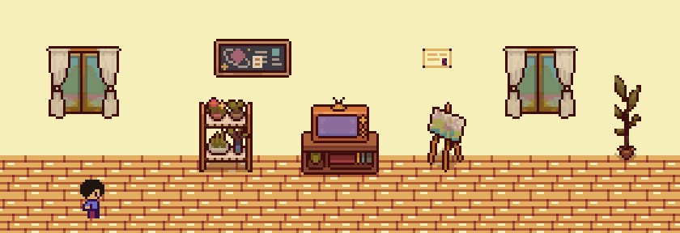

<a href="https://giomhern.vercel.app">
  <picture>
    <source media="(prefers-reduced-motion: reduce)" srcset="assets/profile-header.png" />
    
  </picture>
</a>

## Hi, I'm Giovanni 👋

I'm studying **Computer Science and Data Science at UChicago**. I like building useful things and making them cool.

I've worked on data pipelines, backend services, mobile apps, and robots through internships at **Shopify, Twilio, Microsoft**, and research at UChicago's
**Human-Robot Interaction Lab**.

[enter my pixel world ↗](https://giomhern.vercel.app) · [linkedin](https://www.linkedin.com/in/giomhern/) ·
[resume](https://drive.google.com/file/d/1N_6xUhT_TKhudti_gOixAYbyPmTv-5O2/view?usp=sharing)

---

**languages & tools**

`Python` · `TypeScript` · `Java` · `SQL` · `Haskell` · `C/C++`

`React / Next.js` · `Spring Boot` · `PyTorch` · `dbt / BigQuery` · `Airflow` · `ROS 2`

---

A few things I've built: [a Smiski classifier](https://github.com/giomhern/is-it-a-smiski), [a Block Blast bot](https://github.com/giomhern/blockbast-ai), and
[Conway's Game of Life in Haskell](https://github.com/giomhern/game-of-life).
